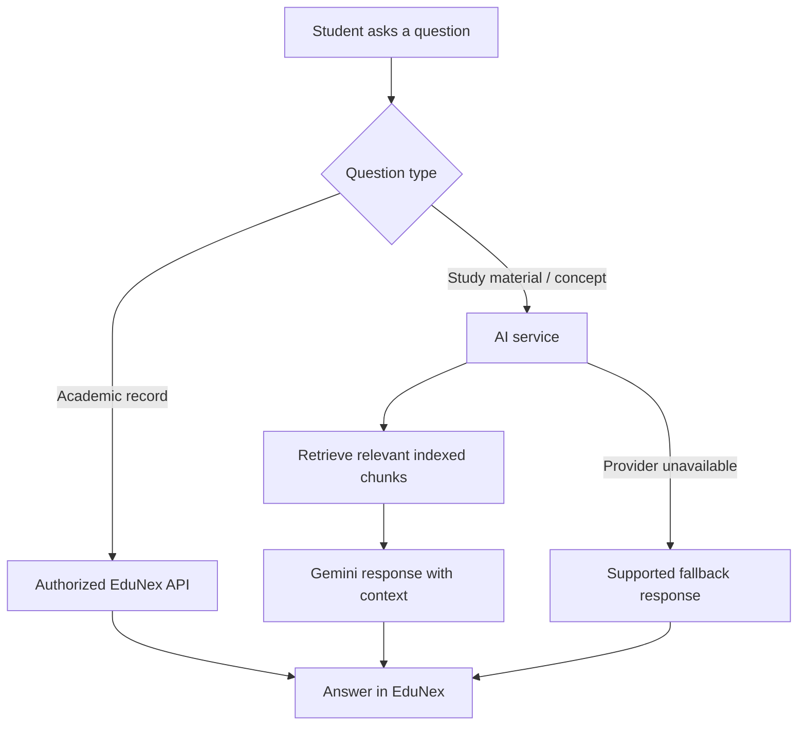
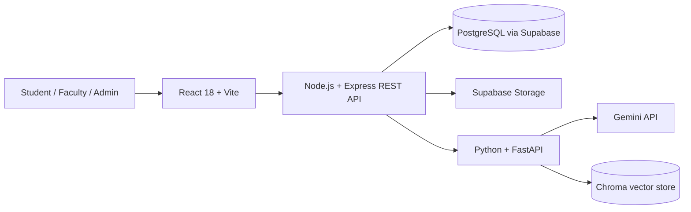

# EduNex
### AI-Powered College Management & Student Success Platform

<p align="center">
  <strong>One campus. One connected experience.</strong><br/>
  Academic management, student success tools, and an AI learning assistant in one full-stack platform.
</p>

<p align="center">
  <a href="https://edunex-kshitij.vercel.app"></a>
  <a href="https://edunex-l5tx.onrender.com/api/health"></a>
  <a href="https://edunex-ai.onrender.com/health"></a>
</p>

<p align="center">
  
  
  
  
  
  
  
  
</p>

---

## Explore

- [✨ What is EduNex?](#-what-is-edunex)
- [🚀 Live links](#-live-links)
- [🧩 Platform features](#-platform-features)
- [🤖 AI and smart learning](#-ai-and-smart-learning)
- [🏗️ Architecture](#️-architecture)
- [🛡️ Security and access control](#️-security-and-access-control)
- [🧰 Technology stack](#-technology-stack)
- [⚙️ Run locally](#️-run-locally)
- [🌐 Deployment](#-deployment)
- [🗺️ Roadmap and project status](#️-roadmap-and-project-status)
- [🤝 Contributing](#-contributing)
- [📄 License](#-license)

## ✨ What is EduNex?

**EduNex** is a full-stack college management and student-success platform designed around three campus roles: **students, faculty, and administrators**. It brings academic workflows, learning resources, student planning, analytics, and AI-assisted study into one application.

The goal is to make academic information easier to manage and understand—from attendance and marks to assignments, study materials, timetables, and personalized learning support.

> **Project focus:** connected academic workflows + useful student tools + AI-assisted learning.

<p align="center">
  <a href="https://edunex-kshitij.vercel.app"><strong>➡️ Open the EduNex web app</strong></a>
</p>

## 🚀 Live links

| Service | Link | Purpose |
|---|---|---|
| EduNex web app | [Open application](https://edunex-kshitij.vercel.app) | React frontend |
| Node API | [API health](https://edunex-l5tx.onrender.com/api/health) | Backend service health |
| Database readiness | [Database check](https://edunex-l5tx.onrender.com/api/ready) | Checks whether the API can query PostgreSQL |
| AI service | [AI health](https://edunex-ai.onrender.com/health) | FastAPI service health |
| Source code | [GitHub repository](https://github.com/kshitijmohankar-7/EduNex) | Code, migrations, and configuration |

> **Note:** The health links report service/connectivity status; they are not a guarantee of uninterrupted availability. Sign in with an authorized EduNex account. No demo credentials are published in this repository.

## 🧩 Platform features

<details open>
<summary><strong>🎓 Student experience</strong></summary>

- Student dashboard and academic overview
- Attendance tracking and academic performance views
- Marksheets and published marks
- Assignments, submissions, results, and feedback
- Study materials and question banks
- Open elective visibility in relevant academic workflows
- AI chat, academic insights, exam preparation, quizzes, flashcards, and study planning
- Campus planner, timetable, announcements, and notifications
- Learning streaks, skill profile, resume builder, and career recommendations
- Events, clubs, internships, placements, certificates, library, fees, hostel, and transport pages
- Leave requests, help desk, communication, goals, focus/study timers, and preferences

</details>

<details>
<summary><strong>👩‍🏫 Faculty workspace</strong></summary>

- Faculty dashboard and analytics
- Attendance entry and management
- Marks entry, marksheets, and explicit mark publishing
- Assignment creation, submission review, grading, and feedback
- Study-material and question-bank management
- Subject-scoped access and faculty-to-subject assignment controls
- Student details and subject requests
- RAG material indexing and re-indexing dashboard
- Timetable/planner views, announcements, notifications, and leave-request workflows

</details>

<details>
<summary><strong>🛠️ Administrator workspace</strong></summary>

- Admin dashboard, overview, and analytics
- Student and faculty account management
- Department, course, semester, division, and subject administration
- Faculty-to-subject assignments
- Timetable management by semester, division, subject, faculty, room, and class type
- Announcements, exam schedules, feedback, and audit-related views
- Role-aware access to campus management workflows

</details>

<details>
<summary><strong>📊 Academic and campus workflows</strong></summary>

- Attendance and academic record management
- CT1, CT2, internal, external, and end-semester marks
- SGPA/CGPA calculation and marksheet publishing
- Assignment lifecycle: create → submit → review → grade → feedback
- Announcements and notifications
- Monday–Saturday timetable views with current-day and next-class highlights
- Assignment deadline and noticeboard context alongside planning
- Responsive layouts for desktop and smaller screens

</details>

## 🤖 AI and smart learning

EduNex connects the main application to a separate Python/FastAPI AI service.

- **AI learning assistant:** ask academic and conceptual questions.
- **Retrieval-Augmented Generation (RAG):** retrieve relevant context from indexed study materials for grounded answers.
- **Study-material ingestion:** extract text from PDF and DOCX files, split it into chunks, and create embeddings.
- **Vector retrieval:** Chroma stores searchable document chunks for the RAG workflow.
- **Academic context:** supported questions can use authorized academic information such as attendance, marks, and assignments.
- **AI study tools:** study planning, exam preparation, quizzes, flashcards, and academic insights.
- **Resilience:** deterministic/offline fallbacks are available for supported questions when Gemini is unavailable or quota-limited.
- **Faculty indexing tools:** inspect and re-index study materials when needed.

**Typical learning flow**



RAG quality depends on available, successfully indexed materials and embedding/model availability. AI responses should be checked against official academic information when accuracy is important.

## 🏗️ Architecture



| Component | Directory | Responsibility |
|---|---|---|
| Frontend | `client/` | React UI, routing, dashboards, charts, and user workflows |
| Backend | `server/` | REST API, authentication, authorization, academic business logic |
| AI service | `ai-service/` | FastAPI endpoints, Gemini integration, document ingestion, RAG |
| Database migrations | `database/migrations/` | SQL schema changes and feature migrations |
| Deployment blueprint | `render.yaml` | Render service configuration |

## 🛡️ Security and access control

- JWT-based authentication and role-protected routes/APIs
- Role-aware navigation for students, faculty, and administrators
- Students' academic records are scoped to the authenticated student
- Faculty write operations are scoped to assigned subjects and relevant ownership
- Admin-only management for privileged campus workflows, including timetable changes
- Marks are explicitly published rather than automatically exposed during editing
- AI academic requests receive authorized user context
- Production secrets belong in hosting-provider environment settings, never in source control

**Security reminder:** never commit real `.env` files, database passwords, JWT secrets, Supabase service-role keys, or Gemini API keys.

## 🧰 Technology stack

| Layer | Technologies |
|---|---|
| Frontend | React 18, Vite, React Router, Recharts |
| Backend | Node.js, Express, PostgreSQL client (`pg`), JWT, bcryptjs, Multer |
| AI | Python, FastAPI, Google Gemini API |
| Retrieval | PDF/DOCX extraction, chunking, embeddings, Chroma |
| Database and file storage | PostgreSQL, Supabase Storage |
| Hosting | Vercel frontend; Render API and AI service |
| Development | Git, GitHub, npm, Python virtual environments |

## ⚙️ Run locally

<details>
<summary><strong>Show setup instructions</strong></summary>

### Prerequisites

- Node.js and npm
- Python 3.12 recommended for the deployed AI service
- PostgreSQL, or a configured PostgreSQL-compatible database
- A Gemini API key for live Gemini features
- Supabase project and Storage bucket if testing cloud storage

### 1. Configure environment variables

Create local environment files based on:

- `server/.env.example`
- `ai-service/.env.example`

Configure the database connection, JWT secret, frontend origin, AI service URL, storage mode, and Gemini key as needed. Use local-only secrets; do not commit them.

### 2. Set up the database

For a **new local installation**, inspect the repository's database schema/seed files first. For an existing installation, apply only migrations that have not already been applied, in order.

Available feature migrations include:

```text
database/migrations/2026-09-11-phase1-admin-questionbank-grading.sql
database/migrations/2026-09-12-phase2.sql
database/migrations/2026-09-14-phase3.sql
database/migrations/2026-09-15-campus-planner.sql
```

Example for Windows PowerShell (run only the migration needed for your database):

```powershell
psql -U postgres -d edunex -f database\migrations\2026-09-15-campus-planner.sql
```

If `psql` is not on PATH, use the full path to your installed PostgreSQL `psql.exe`.

### 3. Start the backend

```powershell
cd server
npm install
npm run dev
```

Default local API: `http://localhost:5000`

### 4. Start the AI service

In a second terminal:

```powershell
cd ai-service
python -m venv .venv
.\.venv\Scripts\Activate.ps1
pip install -r requirements.txt
python -m uvicorn main:app --reload --port 8000
```

Default local AI service: `http://localhost:8000`

### 5. Start the frontend

In a third terminal:

```powershell
cd client
npm install
npm run dev
```

Default local frontend: `http://localhost:5173`

Configure the frontend API base URL to point at your local backend (for example, `http://localhost:5000/api`) using the client environment configuration expected by the app.

### 6. Verify

- API health: `GET http://localhost:5000/api/health`
- Database readiness: `GET http://localhost:5000/api/ready`
- AI health: `GET http://localhost:8000/health`
- Verify login, role-based access, uploads, attendance, assignments, marks, timetable, and AI/RAG workflows.

</details>

## 🌐 Deployment

EduNex is deployed as separate services:

| Part | Hosting | Repository root |
|---|---|---|
| Web frontend | Vercel | `client/` |
| REST API | Render | `server/` |
| AI/RAG service | Render | `ai-service/` |
| PostgreSQL and file storage | Supabase | Managed project/bucket |

### Environment configuration overview

<details>
<summary><strong>Frontend environment</strong></summary>

```env
VITE_API_BASE_URL=https://your-api-host.example/api
VITE_API_TIMEOUT_MS=30000
```

</details>

<details>
<summary><strong>Backend environment</strong></summary>

Use `server/.env.example` as the reference. Common production variables include:

```env
NODE_ENV=production
PORT=5000
DATABASE_URL=...
DATABASE_SSL=true
JWT_SECRET=...
JWT_EXPIRES_IN=7d
CLIENT_URL=https://your-frontend-domain.example
AI_SERVICE_URL=https://your-ai-service.example
STORAGE_MODE=supabase
SUPABASE_URL=...
SUPABASE_SERVICE_ROLE_KEY=...
SUPABASE_STORAGE_BUCKET=edunex-files
```

</details>

<details>
<summary><strong>AI service environment</strong></summary>

Use `ai-service/.env.example` and set the Gemini API key, model configuration, allowed frontend origin, and persistent Chroma path. Never expose provider keys to the frontend.

</details>

The repository includes `render.yaml` as a deployment blueprint. Hosting plans, quotas, and provider availability may affect cold starts and uptime. Review the provider dashboards if a service or database is paused.

## 🗺️ Roadmap and project status

EduNex has evolved beyond an initial scaffold and includes core academic management, AI/student-success tools, analytics, and campus planner/timetable workflows. This README describes the repository's intended feature set; individual integrations may depend on configured environment variables, database migrations, provider quotas, and deployment status.

Possible future improvements:

- [ ] Add curated screenshots and a short product demo
- [ ] Expand automated API and end-to-end tests
- [ ] Add CI checks for linting, builds, and migrations
- [ ] Improve observability for AI/RAG indexing and provider quota failures
- [ ] Document a safe demo-account provisioning workflow
- [ ] Add accessibility checks and performance budgets

## 🤝 Contributing

Contributions, bug reports, and suggestions are welcome.

1. Fork the repository.
2. Create a focused branch.
3. Make and test your changes.
4. Open a pull request with a clear summary and test notes.

Please do not include personal student data, real credentials, private uploaded documents, or production secrets in issues or pull requests.

## 📄 License

No license file was confirmed as part of this README update. Unless a license is added to the repository, reuse and redistribution remain subject to the repository owner's rights.

---

<p align="center">
  <strong>EduNex — supporting better campus workflows and student success.</strong><br/>
  <a href="https://edunex-kshitij.vercel.app">Live app</a> ·
  <a href="https://github.com/kshitijmohankar-7/EduNex">Source code</a> ·
  <a href="https://edunex-l5tx.onrender.com/api/health">API status</a>
</p>
